# Análise de tráfego com Wireshark

Exercício de análise de tráfego e relatório de incidente com Wireshark, a partir de uma captura pública do site Malware-Traffic-Analysis.net. O trabalho foi feito numa máquina virtual Kali Linux, só com leitura da captura. Nada foi executado.

Fonte do exercício: https://www.malware-traffic-analysis.net/2026/10/01/index.html

## O cenário

Num centro de operações de segurança (SOC), dois alertas chamam a atenção para um computador Windows da rede interna.

- Um ficheiro executável do Windows (EXE) foi enviado a partir de 107.175.82[.]242 na porta 9000, uma porta invulgar para este tipo de transferência
- Tráfego de comando e controlo (C2) de um RAT para 195.64.128[.]106 na porta 443

A captura é o tráfego desse computador Windows e serve para confirmar os alertas e identificar a máquina infetada.

Características do ambiente, dadas no enunciado do exercício.

- Rede local: 10.10.1.0/24
- Domínio: natureforce.com
- Nome do ambiente Active Directory: NATUREFORCE
- Controlador de domínio: 10.10.1.10 (WIN-LEKBU2OY51N)
- Gateway: 10.10.1.1
- Broadcast: 10.10.1.255

## Respostas do relatório de incidente

| Pergunta | Resposta |
|---|---|
| Endereço IP do cliente Windows infetado | 10.10.1.128 |
| Endereço MAC do cliente Windows infetado | 00:22:fb:ec:7e:e7 |
| Nome do host do cliente Windows infetado | DESKTOP-4VGYQX7 |
| Nome da conta de utilizador do cliente Windows infetado | bdiaz |
| Hash SHA-256 do EXE enviado de 107.175.82[.]242:9000 para o cliente | b789adce70c028a6d17be45ec34667aa95586350ee0c4057e75b138b1ad35061 |

## A captura

Ficheiro: `2026-10-01-traffic-analysis-exercise.pcap`

| Propriedade | Valor |
|---|---|
| Tamanho do ficheiro | 36 MB |
| Hash SHA256 da captura | 287d6dee90cfef71f98a97c42e30444608de2cf59d2f7392a0a6df8dbbc8274b |
| Hash SHA1 da captura | 719ad4feb53aba57798564d354660d6513fa3a61 |
| Formato | pcap, encapsulamento Ethernet |
| Primeiro pacote | 2026-10-01 15:27:27 |
| Último pacote | 2026-10-01 16:07:58 |
| Duração | 00:40:31 |
| Total de pacotes | 42 497 |
| Tamanho médio de pacote | 851 bytes |
| Média | 17,5 pacotes por segundo |

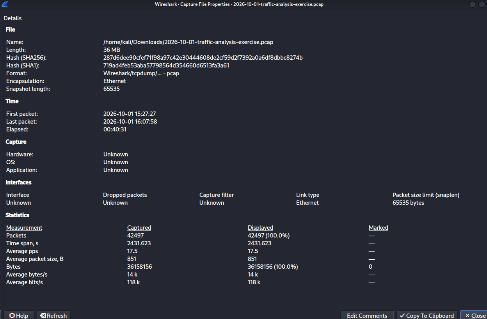

## Como cheguei a cada resposta

### 1. Hierarquia de protocolos

Statistics, Protocol Hierarchy. O TCP domina a captura com 97,9% dos pacotes. Dentro do TCP, o TLS ocupa 24,3%, por isso há muito tráfego encriptado (HTTPS) que não dá para ler por dentro. O HTTP aparece com apenas 0,1%, mas em capturas de malware um só pacote HTTP pode ser o suficiente para descarregar o payload inicial, por isso o número baixo não quer dizer que o HTTP não interessa.

Outros valores que se veem na hierarquia: IPv4 99,6%, UDP 1,7%, QUIC 0,6%, DNS 0,8%, LDAP 0,5%, Kerberos 0,1%, NetBIOS Session 1,0% com SMB2 1,0%.

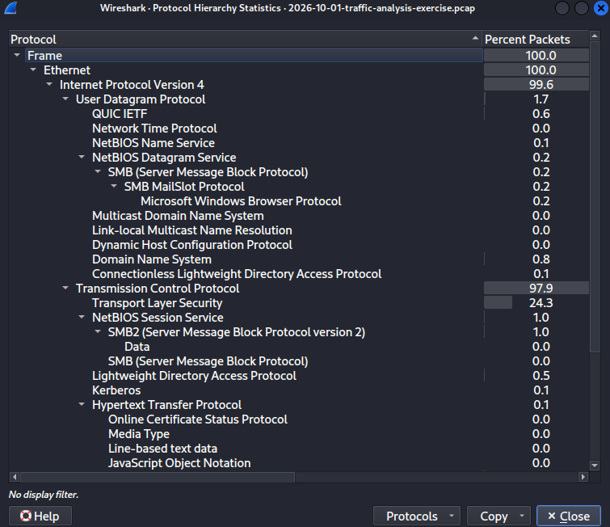

### 2. Endpoints, quem fala mais na rede

Statistics, Endpoints. Nos endereços Ethernet são só 6. O MAC 00:22:fb:ec:7e:e7 tem 42 495 pacotes, praticamente todos os pacotes da captura. Nos endereços IPv4 são 74. O IP 10.10.1.128 tem 42 340 pacotes e 36 MB, a esmagadora maioria. É assim que se identifica o cliente infetado, é o endereço que domina a captura nos dois lados.

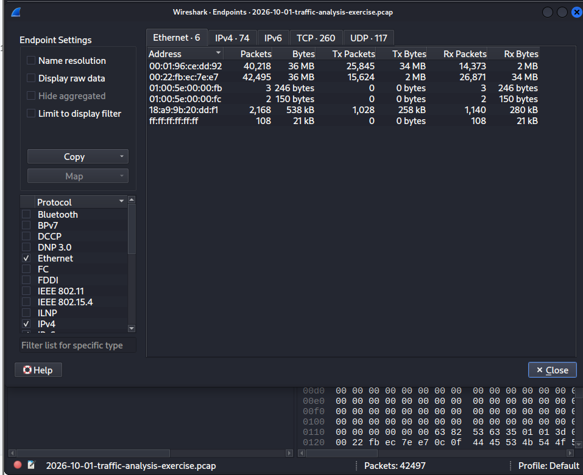

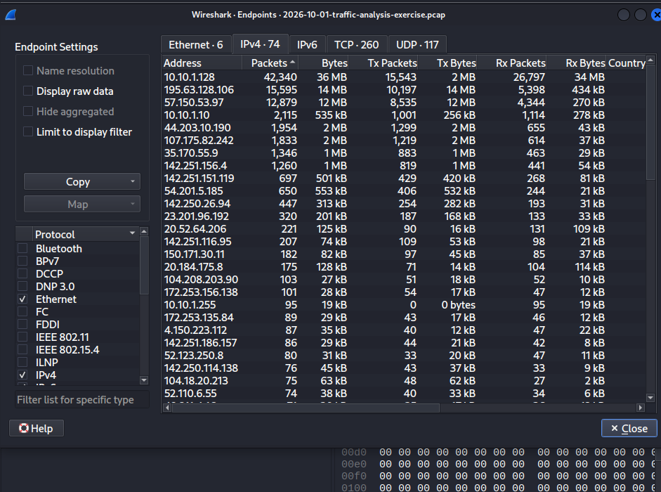

Os outros endereços que se destacam nos endpoints IPv4.

- 195.63.128.106 com 15 595 pacotes e 14 MB, o maior interlocutor externo. Ver a nota sobre este endereço mais abaixo.
- 57.150.53.97 com 12 879 pacotes e 12 MB
- 10.10.1.10 com 2 115 pacotes, o controlador de domínio
- 107.175.82.242 com 1 833 pacotes e 2 MB, a origem do EXE
- 35.170.55.9 com 1 346 pacotes, o servidor de holtandberyl.com

### 3. ARP, confirmar o gateway e o MAC do cliente

Filtro: `arp`

O pacote 6 é o cliente a perguntar quem tem o endereço 10.10.1.1. A resposta vem do MAC 00:01:96:ce:dd:92 (Cisco), que é o gateway. Na mesma lista vê-se que o endereço 10.10.1.10 está no MAC 18:a9:9b:20:dd:f1 (Dell), que é o controlador de domínio. O endereço 10.10.1.128 está no MAC 00:22:fb:ec:7e:e7 (Intel), o MAC do cliente infetado.

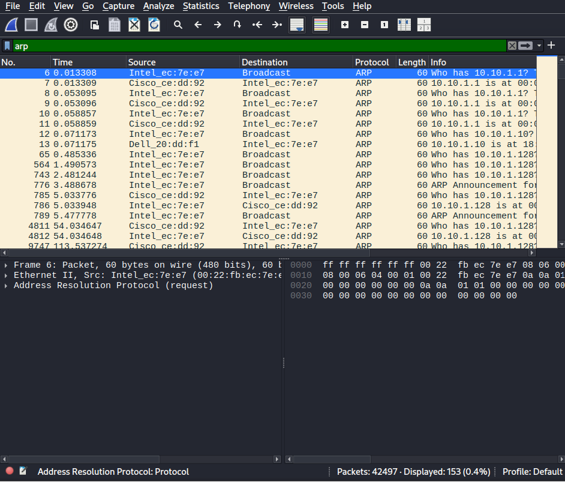

### 4. NBNS, confirmar o nome do host

Filtro: `nbns`

O pacote 33 é o cliente 10.10.1.128 a registar o nome `DESKTOP-4VGYQX7<00>` no endereço de broadcast 10.10.1.255. Na mesma lista aparecem registos de `NATUREFORCE<00>`, `DESKTOP-4VGYQX7<20>`, `NATUREFORCE<1e>` e `NATUREFORCE<1d>`. O nome NATUREFORCE bate com o nome do domínio do enunciado, o que confirma que a máquina está integrada no domínio da empresa.

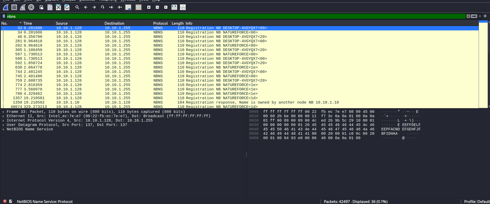

### 5. Kerberos, confirmar o nome do host e descobrir o utilizador

Filtro: `kerberos.CNameString`

São 33 pacotes. O pacote 95 é um AS-REP do controlador de domínio 10.10.1.10 para o cliente 10.10.1.128, com o campo CNameString a mostrar `DESKTOP-4VGYQX7$`. O cifrão no fim indica que é uma conta de máquina e não de uma pessoa, por isso este pacote confirma o nome do host mas não o utilizador.

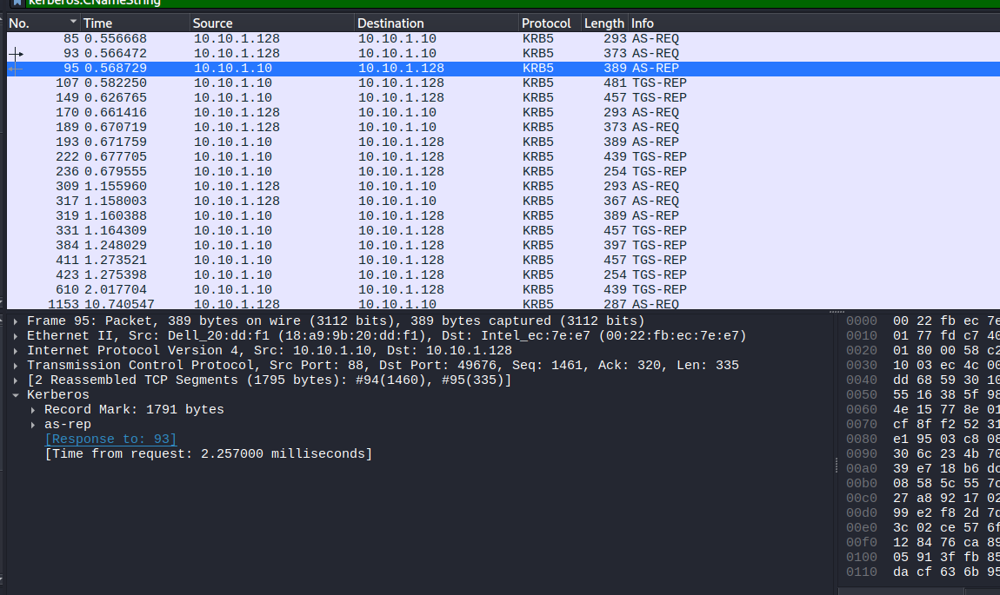

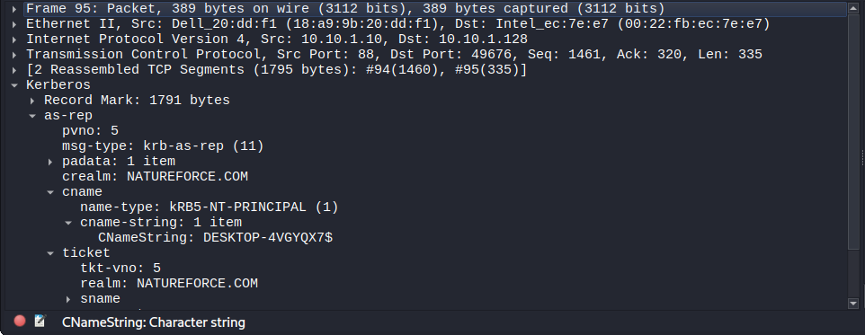

Para encontrar o utilizador é preciso tirar as contas de máquina da lista. O filtro usado foi `kerberos.cname_string == 1 and !(kerberos.CNameString contains "$")`, que deixa só os nomes sem cifrão. São 11 pacotes. O pacote 1342 é um TGS-REP do controlador de domínio para o cliente, com CNameString `bdiaz` e serviço `krbtgt/NATUREFORCE.COM`. É assim que se chega ao nome da conta de utilizador.

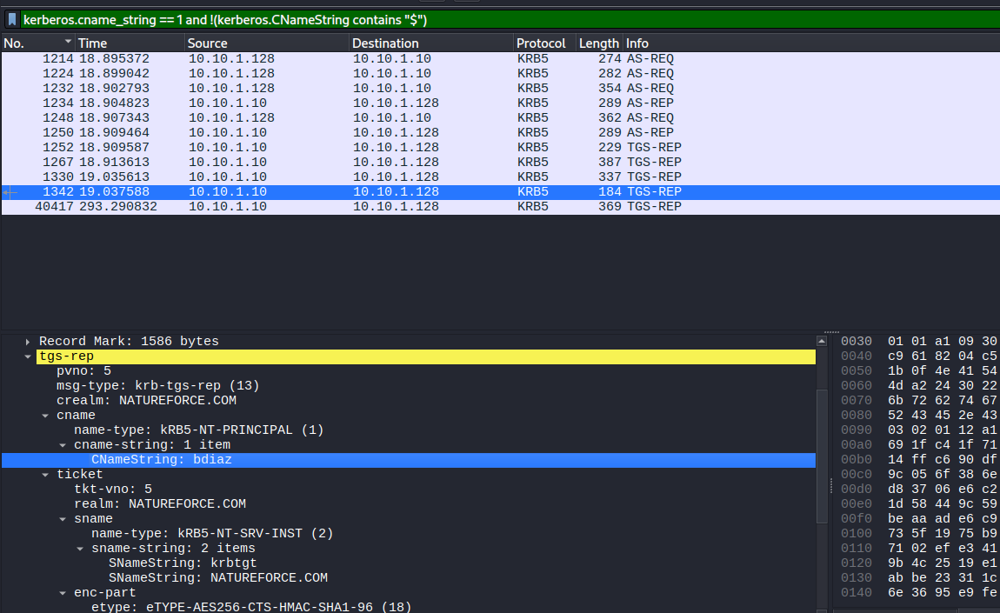

### 6. Exportar o EXE e confirmar o hash

File, Export Objects, HTTP. Na lista, o pacote 24916 destaca-se logo: hostname `107.175.82.242:9000`, tipo `binary/octet-stream`, tamanho 1 646 kB, ficheiro `runner_ilove.exe`. Os outros objetos da lista são ficheiros normais, como `connecttest.txt`, respostas OCSP e listas de revogação de certificados.

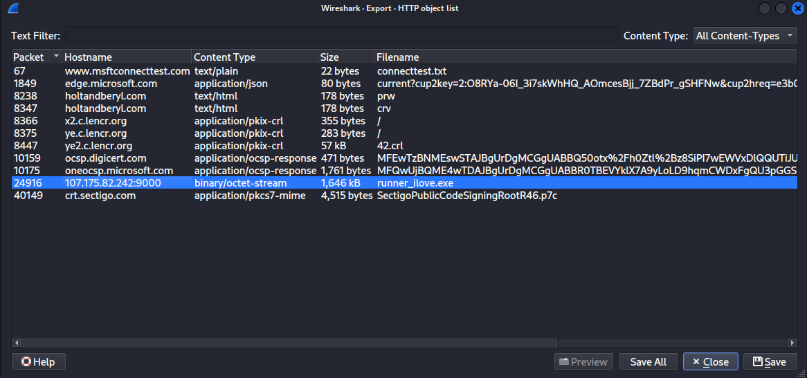

Depois de exportar o ficheiro, o comando `sha256sum runner_ilove.exe` dá o hash `b789adce70c028a6d17be45ec34667aa95586350ee0c4057e75b138b1ad35061`, que é a resposta à última pergunta do relatório.

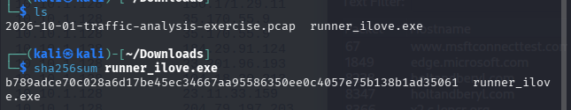

### 7. O que o VirusTotal diz do ficheiro

Consulta do hash no VirusTotal. Na altura da consulta, 48 em 71 motores de segurança marcavam o ficheiro como malicioso. O nome original do ficheiro é `service.exe` e o tamanho é 1,57 MB. A etiqueta de ameaça mais comum é `trojan.capdoor/zusy`, com as etiquetas de família `capdoor`, `zusy` e `misc`. Alguns dos nomes dados pelos motores são `Trojan/Win.AsyncRAT`, `Backdoor:Win/CapDoor.a` e `Trojan/Win64.Zusy`. A pontuação do VirusTotal muda com novas análises, por isso este valor é o da consulta registada no print e não uma pontuação atual.

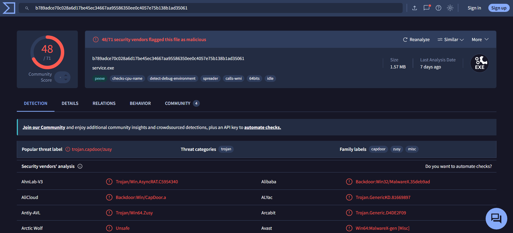

### 8. Um pormenor que vale a pena registar, os pedidos com curl

Filtro: `http.host == "holtandberyl.com"`

São só dois pacotes. O pacote 8235 é um `GET /prw` e o pacote 8345 é um `GET /crv`, os dois do cliente 10.10.1.128 para 35.170.55.9. No detalhe do pacote 8345, o User-Agent é `curl/8.21.0` e não o de um browser. Estes dois pedidos foram feitos com curl e não com navegação normal, ou seja, por um processo automatizado e não por uma pessoa a navegar.

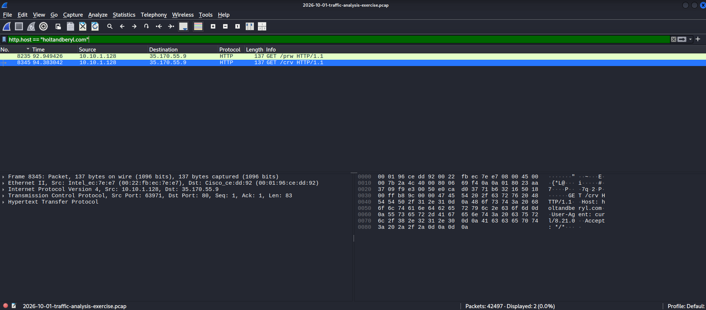

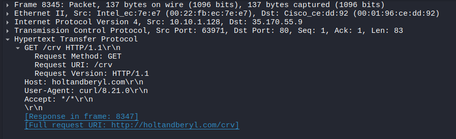

## Nota sobre o endereço de comando e controlo

O alerta na página do exercício diz que o tráfego C2 vai para 195.64.128[.]106 na porta 443. Na captura, o endereço com tráfego é 195.63.128.106, com 15 595 pacotes e 14 MB, e não há nenhum pacote com o endereço 195.64.128.106. Os dois endereços diferem num dígito. Fica registado como está na captura, porque é o endereço que se vê nos endpoints e é o maior interlocutor externo depois do próprio cliente.

## Indicadores

Os indicadores estão também no ficheiro `indicadores.txt`, com os endereços externos desfragmentados (defanged) para não serem clicáveis por engano.

| Indicador | Valor | Nota |
|---|---|---|
| Cliente infetado (IP) | 10.10.1.128 | Domina a captura com 42 340 pacotes |
| Cliente infetado (MAC) | 00:22:fb:ec:7e:e7 | Intel |
| Cliente infetado (host) | DESKTOP-4VGYQX7 | Conta de máquina DESKTOP-4VGYQX7$ no Kerberos |
| Utilizador | bdiaz | CNameString no TGS-REP do pacote 1342 |
| Domínio | natureforce.com | Ambiente NATUREFORCE |
| Controlador de domínio | 10.10.1.10 | WIN-LEKBU2OY51N, MAC 18:a9:9b:20:dd:f1 |
| Gateway | 10.10.1.1 | MAC 00:01:96:ce:dd:92 |
| Origem do EXE | 107.175.82[.]242:9000 | Pacote 24916, ficheiro runner_ilove.exe |
| Hash SHA-256 do EXE | b789adce70c028a6d17be45ec34667aa95586350ee0c4057e75b138b1ad35061 | Nome original service.exe, 1,57 MB |
| C2 na captura | 195.63.128[.]106:443 | 15 595 pacotes, 14 MB |
| Pedidos com curl | holtandberyl.com | GET /prw e GET /crv, User-Agent curl/8.21.0 |

## Filtros usados

Os filtros de ecrã usados nesta análise estão no ficheiro `filtros.txt`.

- `arp`
- `nbns`
- `kerberos.CNameString`
- `kerberos.cname_string == 1 and !(kerberos.CNameString contains "$")`
- `http.host == "holtandberyl.com"`

## Como reproduzir

1. Descarregar a captura na página do exercício. O ficheiro zip está protegido por palavra-passe. A palavra-passe segue o esquema publicado na página "about" do site, `infected_` mais a data de publicação no formato AAAAMMDD. Para este exercício, publicado a 2026-10-01, a palavra-passe é `infected_20261001`.
2. Confirmar o hash SHA256 da captura depois de extrair. Tem de ser `287d6dee90cfef71f98a97c42e30444608de2cf59d2f7392a0a6df8dbbc8274b`.
3. Abrir a captura no Wireshark e seguir os passos deste README, pela mesma ordem.
4. Não executar o ficheiro exportado. A análise é só leitura da captura, numa máquina virtual isolada.

## Ficheiros

| Ficheiro | Conteúdo |
|---|---|
| `README.md` | Este relatório |
| `filtros.txt` | Filtros de ecrã do Wireshark usados na análise |
| `indicadores.txt` | Indicadores do incidente, com endereços externos defanged |
| `imagens/` | 14 prints da análise, um por passo |

A captura `.pcap` e o ficheiro EXE exportado não estão neste repositório. A captura tem 36 MB e contém tráfego real de malware. Quem quiser reproduzir a análise deve descarregar a captura na fonte oficial, com o link acima.

## Limites desta análise

- 24,3% do tráfego é TLS, por isso grande parte do conteúdo está encriptado e não dá para ver o que passa lá dentro. As conclusões baseiam-se nos metadados, nos endpoints, nos protocolos e nos poucos pedidos HTTP em claro.
- O VirusTotal dá uma classificação do ficheiro, não uma prova do que ele fez nesta rede. A deteção confirma que o ficheiro é malicioso, mas o comportamento dele nesta máquina só se vê no tráfego.
- A divergência do endereço C2, 195.63 contra 195.64 no alerta, fica registada como observação da captura e não como correção do alerta.
